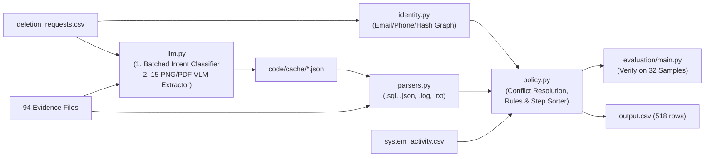

# Ghost Data Still Exists — Architecture & Implementation Plan (`knowledge.md`)

> **Purpose**: Self-contained specification and implementation guide for solving **HackerRank Orchestrate (October 2026) — "Ghost Data Still Exists"**. Designed in strict accordance with `project-rules` (**Rule 1: Think Before Coding**, **Rule 2: Simplicity First**, **Rule 4: Goal-Driven Execution**, **Rule 5: Use the Model Only for Judgment Calls**). A separate engineer or agent with zero prior context can build, test, and verify the entire solution from this document.

---

## 1. Problem Contract & Core Principles

### 1.1 Input & Output Contract
* **Input (`dataset/deletion_requests.csv`)**: 518 evaluation cases sorted numerically (`case_33` … `case_550`), plus 32 ground-truth sample cases in `dataset/sample_deletion_requests.csv` (`case_01` … `case_32`) paired with `dataset/sample_output.csv`.
* **Output (`output.csv` in repository root)**:
  * Header: `case_id,deletion_status,steps_json`
  * Exactly 518 data rows in the **exact numeric order** of `dataset/deletion_requests.csv` (`case_33` … `case_550`).
  * `deletion_status` $\in \{\text{"COMPLETE"}, \text{"INCOMPLETE"}, \text{"NOT\_APPLICABLE"}\}$.
  * `steps_json`: JSON array of ordered step objects (`step_no`, `phase`, `system_id`, `resource_id`, `operation`, `state`, `evidence_id`), or `[]` for `NOT_APPLICABLE`.
  * Evidence citations in `steps_json` always reference `evidence_*` `file_id`s from `evidence_files.csv` (for `FINDING` steps and `COMPLETE` `VERIFICATION` steps) or `""` (for `REMEDIATION` steps and `INCOMPLETE` `VERIFICATION` steps).

### 1.2 Engineering Principles (`project-rules` Compliance)
1. **Use the Model Only for Judgment Calls (Rule 5)**:
   * Deterministic code handles identity graph construction, SQL/JSON/log/text parsing, timestamp filtering, policy evaluation, and canonical step sorting.
   * The LLM/VLM is invoked **only** for the two tasks that require semantic or visual judgment:
     1. **Request Intent Classification**: Distinguishing authorized deletion requests (across English, Spanish, French, Portuguese, Korean, and Japanese) from non-deletion requests (especially tricky negations such as *"Do not close the account"* or *"without removing any of my records"*).
     2. **Multimodal Evidence Extraction**: Reading the 15 binary `.png` and `.pdf` evidence files into structured JSON records.
2. **Real Model Calls + Honest Disk Caching (`code/cache/*.json`)**:
   * We make **real LLM/VLM API calls** once during the full-dataset run, persist the raw model outputs and token usage metadata to `code/cache/*.json`, and report the **actual token counts and costs** from that run in `code/evaluation/usage_report.md` (explicitly noting that subsequent re-runs read from `code/cache/*.json` for fast, deterministic reproducibility).
   * Because the automated code judge ignores `.json` files (`README.md` Line 99), all prompts (`code/llm.py`) and evaluation/usage reports (`code/evaluation/evaluation_report.md`, `code/evaluation/usage_report.md`) are written in `.py` and `.md` files.
3. **Score Against Ground-Truth Samples First (Rule 4)**:
   * `dataset/sample_output.csv` (32 cases) is our ground truth. We build the sample scorer (`code/evaluation/main.py`) **first** and run it after every parser or policy change to verify hypotheses on status accuracy, step accuracy, field accuracy, and sequence order before generating the 518-case `output.csv`.
4. **Dynamic Resolution Over Hardcoding**:
   * `case_id` $\neq$ `user_id` on 510 of the 518 evaluation rows. Production code must **never** hardcode `case_id -> user_id`, cohort-to-file tables, or image contents. It must dynamically resolve `request.email` $\rightarrow$ `user_id` $\rightarrow$ all current and historical identifiers $\rightarrow$ matching records across evidence files.

---

## 2. Simplified 5-Module Architecture (`code/`)

```text
hackerrank-orchestrate-october26/
├── README.md                          # Setup, architecture overview, and run commands
├── knowledge.md                       # This specification
├── log.txt                            # Mandatory AGENTS.md turn-by-turn transcript
├── output.csv                         # Final 518-row submission file (sorted numerically)
└── code/
    ├── main.py                        # Entry point: runs pipeline on deletion_requests.csv -> output.csv
    ├── identity.py                    # Builds user_id equivalence classes from user_identities & user_audit_log
    ├── llm.py                         # Prompts, real LLM/VLM calls, deduplicated batching, code/cache/*.json, token counter
    ├── parsers.py                     # Parses .sql, .json, .log, .txt + loads multimodal extractions from llm.py
    ├── policy.py                      # Unified conflict resolution, deletion_rules mapping, and step sorting
    ├── cache/                         # Cached raw JSON responses & token telemetry from real LLM/VLM calls
    │   ├── intent_cache.json
    │   ├── multimodal_cache.json
    │   └── usage_metrics.json
    └── evaluation/
        ├── main.py                    # Ground-truth scorer (32 sample cases + 3 custom test cases)
        ├── evaluation_report.md       # Accuracy metrics, custom test cases, failure & improvement log
        └── usage_report.md            # Real model call, token, and cost report
```



---

## 3. Exact Dataset Schemas & Join Keys

### 3.1 Master File Schema & Join Reference

| File | Rows | Exact Columns | Join Keys & Semantics |
| :--- | :--- | :--- | :--- |
| `dataset/deletion_requests.csv`<br/>`dataset/sample_deletion_requests.csv` | 518<br/>32 | `case_id,email,requested_at,reported_status,reported_at,audit_at,request_text` | `email` (case-insensitive) joins to `user_identities.email` OR `user_audit_log.old_value` / `new_value` (`field_name == "email"`). |
| `dataset/user_identities.csv` | 850 | `user_id,name,email,phone,email_hash,updated_at` | Current identity per `user_id`. Note: `email_hash` is the **full 64-character SHA-256 hex string** already precomputed in this column. |
| `dataset/user_audit_log.csv` | 306 | `audit_id,user_id,event_time,field_name,old_value,new_value` | `field_name` $\in \{\text{"email"}, \text{"phone"}, \text{"email\_hash"}\}$. Provides historical emails, phones, and full 64-char SHA-256 `email_hash` values per `user_id`. |
| `dataset/evidence_files.csv` | 94 | `file_id,file_path,origin,captured_at` | Manifest of `evidence_01` … `evidence_94`. Only files with `captured_at <= case.audit_at` are eligible for that case. |
| `dataset/system_activity.csv` | 4,011 | `activity_id,event_time,event_type,source_system,target_system,resource_id,reported_result,details` | Operational events (`DELETE_RECORD`, `REDACT_RECORD`, `ANONYMIZE_RECORD`, `DISABLE_DATA_FLOW`, `BLOCK_RESTORE`, `RETAIN_RECORD`, `CLASSIFY_REQUEST`, `LINK_RESOURCE_IDENTITY`, `SYNC_RECORD`, `INDEX_RECORD`, `UPDATE_RECORD`, `REFRESH_CACHE`, `SEND_EMAIL`). |
| `dataset/deletion_rules.csv` | 15 | `rule_id,data_category,condition,required_action` | Policy rules (`rule_01` … `rule_15`) mapping data categories to `DELETE`, `REDACT`, `ANONYMIZE`, or `RETAIN`. |

### 3.2 Identity Equivalence Class (`code/identity.py`)
For each `user_id` in `user_identities.csv`, collect:
* `user_id`: e.g. `"user_42"`
* `names`: `{row["name"].strip().lower()}`
* `emails`: `{row["email"].strip().lower()}` $\cup$ `{old_value.strip().lower(), new_value.strip().lower()}` from `user_audit_log.csv` where `field_name == "email"`.
* `phones`: `{row["phone"].strip()}` $\cup$ `{old_value.strip(), new_value.strip()}` from `user_audit_log.csv` where `field_name == "phone"` (also index digits-only `re.sub(r"\D", "", p)`).
* `email_hashes`: `{row["email_hash"].strip().lower()}` $\cup$ `{old_value.strip().lower(), new_value.strip().lower()}` from `user_audit_log.csv` where `field_name == "email_hash"`.
  * **Matching rule for `email_hash`**: Every hash in the text/SQL/JSON/log evidence (58 occurrences) is the **full 64-character SHA-256** and matches `email_hashes` by exact string equality (after stripping any `"sha256:"` prefix). Use prefix matching (`full_hash.startswith(short_hash)`) **only** when matching a shortened hash extracted from a UI screenshot (e.g., `evidence_42`).

### 3.3 Resolving `case_id` $\rightarrow$ `user_id`
Given a request row with `req_email = row["email"].strip().lower()`:
1. Look up `req_email` in the inverted index `email_to_user_id` (built from `user_identities.email` and `user_audit_log` `email` changes).
2. Every request in both `sample_deletion_requests.csv` (32 rows) and `deletion_requests.csv` (518 rows) maps uniquely to a single `user_id` via `email_to_user_id`.
3. Note that 3 users (`user_07`, `user_17`, `user_18`) have **two** cases audited at different dates (`audit_at` months apart), which is why all evidence and activity filtering must be scoped to the case's temporal window (`captured_at <= case.audit_at`).

---

## 4. LLM & Multimodal Module (`code/llm.py`)

Following **Rule 5 (Use the model only for judgment calls)**, `code/llm.py` handles two tasks, caches raw responses in `code/cache/*.json`, and logs exact token counts (`prompt_tokens`, `completion_tokens`, `total_tokens`, `model`, `latency_ms`) to `code/cache/usage_metrics.json`.

### 4.1 Judgment Call 1: Deduplicated Request Intent Classification
* Across all 518 evaluation requests (and 32 sample requests), there are **375 unique `request_text` strings** across 6 languages: **English, Spanish, French, Portuguese, Korean, and Japanese**.
* **Trap to Avoid**: Negated non-deletion requests contain deletion keywords (`"close"`, `"removing"`) inside negations:
  * *"I'd like to download my account information in a portable format. Please keep the account as it is."* (`case_535`)
  * *"I can't access my profile and need help resetting the login. Do not close the account."* (`case_536`)
  * *"My surname is misspelled on the account. Can you correct it without removing any of my records?"* (`case_537`)
  * *"I need a copy of last year's invoices for my records. Please leave my profile and purchase history in place."* (`case_540`)
* **Deduplication & Batching**:
  1. Deduplicate `request_text` strings first (at most 375 unique strings).
  2. Filter out unambiguous standard boilerplate templates only when there are zero negation/support markers, or batch the unique `request_text` strings (e.g., in batches of 40–50) into `INTENT_CLASSIFICATION_PROMPT` returning `{"id": ..., "intent": "DELETION" | "NON_DELETION"}`.
  3. Cross-check with `system_activity.csv` (`CLASSIFY_REQUEST` on `privacy_case_management`) and `evidence_50` (`security_audit_ledger_20261001.json`): if either the LLM intent classifier or `CLASSIFY_REQUEST` flags the case as non-deletion (and ensure both agree on `case_533` … `case_542`), output `NOT_APPLICABLE, []`.

### 4.2 Judgment Call 2: Multimodal Extraction for the 15 PNG/PDF Files
* There are exactly **15 multimodal files** (`4 PDFs + 11 PNGs`) in `dataset/evidence_files.csv`:
  * PDFs (`evidence_18, 27, 55, 58`)
  * PNGs (`evidence_04, 09, 14, 19, 23, 28, 32, 37, 42, 46, 60`)
* `code/llm.py` sends each of the 15 files once to the multimodal model with `MULTIMODAL_EXTRACTION_PROMPT`, requesting structured JSON:
  ```json
  {
    "records": [
      {
        "system_id": "account_service | search_service | support_platform | analytics_platform | export_service | object_storage | marketing_platform | integration_service | backup_service | security_service | legal_service | identity_service",
        "resource_id": "string (e.g. account_5762, support_001, ORD-20264118, delivery_confirmation_19.pdf)",
        "record_type": "USER_PROFILE | SEARCH_INDEX_ENTRY | SUPPORT_MESSAGE | SUPPORT_ATTACHMENT | ANALYTICS_PROFILE | USER_EXPORT | MARKETING_PROFILE | DATA_FLOW | BACKUP_ARCHIVE | SECURITY_AUDIT_LOG | LEGAL_HOLD_RECORD | ACCOUNT_TOMBSTONE",
        "state": "PRESENT | ABSENT | REDACTED | ANONYMIZED | ACTIVE | DISABLED | BLOCKED",
        "user_id": "string or null",
        "email": "string or null",
        "phone": "string or null",
        "full_name": "string or null",
        "email_hash": "string or null"
      }
    ]
  }
  ```
* **Bridging Multimodal Display Labels to Canonical `resource_id`s via `LINK_RESOURCE_IDENTITY`**:
  * Some screenshots/PDFs display a filename or reference number alongside or instead of the internal `resource_id` (for example, `evidence_18` shows reference `NST-2026-0718-1842`, `evidence_42` shows `user_17`, and `evidence_46` shows object key `delivery_confirmation_19.pdf`).
  * In `system_activity.csv`, the 12 `LINK_RESOURCE_IDENTITY` rows (`activity_4000` … `activity_4011`) have `details` strings of the form:
    * `"Data catalog linked <resource_id> (<label>) to <email> and <user_id>."`
    * `"Attachment catalog confirmed <resource_id> (<label>) belongs only to <email> and <user_id>; no other subject is linked."`
  * By parsing `LINK_RESOURCE_IDENTITY` rows dynamically from `system_activity.csv` (matching `(target_system, label/email/user_id)` and timestamp `captured_at <= event_time <= audit_at`), our parser automatically resolves any display label (`NST-2026-0718-1842` $\rightarrow$ `export_1842`, `delivery_confirmation_19.pdf` $\rightarrow$ `object_19`, `user_17` on `identity_service` $\rightarrow$ `tombstone_17`) without hardcoding!
  * Also note: `evidence_27` (`legal_retention_register_20260529.pdf`) lists disputed order numbers `ORD-20264118` … `ORD-20264600` (`user_08, 12, 17, 21, 24, 29`), which are finance register entries without a `legal_hold_*` `resource_id` or `RETAIN_RECORD` activity—testing on `sample_output.csv` (`case_08, 12, 17, 21, 24, 29`) confirms these do not generate `legal_service` steps.

---

## 5. Unified Evidence Parsing & Conflict Resolution (`code/parsers.py` & `code/policy.py`)

### 5.1 Normalized Record Representation
Every parser (`.sql`, `.json`, `.log`, `.txt`, and multimodal `.png`/`.pdf`) emits records in a single canonical structure:
* `(evidence_id, file_captured_at, record_observed_at, system_id, resource_id, data_category, state, user_id, emails, phones, names, email_hashes)`
* Where `state` is normalized at parse time to one of:
  * `"PRESENT"` (record exists / identifiable / hit / HTTP 200 / `download_available=true` / `record_present=1`)
  * `"ABSENT"` (record deleted / HTTP 404 / `rows=0` / `result=miss` / `NOT_FOUND` / `download_available=false` / `record_present=0`)
  * `"REDACTED"` (`support_*` shared ticket or `tombstone_*` with direct PII fields `null` / `pii_fields="none"`)
  * `"ANONYMIZED"` (`analytics_*` with `user_id`, `email`, `phone`, `email_hash` all `null` / `anonymized=1`)
  * `"ACTIVE"` (`data_flow_*` with `enabled=true` or `backup_*` with `restore_allowed=true`)
  * `"DISABLED"` (`data_flow_*` with `enabled=false`)
  * `"BLOCKED"` (`backup_*` with `restore_allowed=false`)

### 5.2 Format-Specific Parsing Details (`code/parsers.py`)
1. **`.sql` Files (24 files)**:
   * Execute in an in-memory `sqlite3.connect(":memory:")` instance! (Every `.sql` file in `dataset/evidence/databases/` is valid SQLite SQL, as noted in `README.md` Line 59: *"The `.sql` files are readable as text and executable with SQLite."* Executing via `sqlite3` in memory avoids brittle regex parsing of SQL `INSERT` statements!).
   * Inspect table names via `SELECT name FROM sqlite_master WHERE type='table'`:
     * **JSON-payload tables (`customer_data_primary`, `customer_data_read_replica`, `customer_data_regional_replica_eu`, `customer_data_regional_replica_us`, `customer_data_reporting_replica`, `customer_data_failover_replica`)**: parse `record_json` and `updated_at`.
     * **Relational inventory tables (`customer_profiles`, `customer_search_documents`, `customer_analytics_profiles`, `support_records`, `customer_exports`, `connector_subscriptions`, `backup_restore_entries`, `security_audit_records`)**: read columns directly and join `captured_at` from `snapshot_scope`.
     * **Special single tables (`customer_profiles_failover_replica` in `evidence_54`, `search_documents_primary` in `evidence_57`)**:
       * Note on `evidence_54` (`customer_accounts_failover_replica_20260902.sql`): Only `account_005` (plus decoys `account_8741`, `account_9116`) is present as a row in `customer_profiles_failover_replica`. For users `user_01`..`user_08` whose `account_00X` was deleted from `evidence_54` (`case_01, 02, 04, 06, 07, 08`), `evidence_54` proves `account_00X` is `ABSENT` when `account_00X` is not in the table!
2. **`.json` Files (28 files)**:
   * **`records_assurance_snapshot_bundle`**: iterate `snapshots[]`, using `sub_snapshot["captured_at"]` as `record_observed_at`. If an `account_*` record appears in an earlier `customer_profiles` sub-snapshot (`record_observed_at < case.reported_at`) and is omitted from a later `customer_profiles` sub-snapshot (`case.reported_at <= sub_snapshot.captured_at <= case.audit_at`), emit a synthetic `"ABSENT"` observation at that later sub-snapshot's `captured_at`!
   * **`service_resource_export`**: iterate `service_exports` dictionary (`account_service`, `search_service`, `analytics_platform`, `support_platform`, `export_service`, `integration_service`, `backup_service`, `security_service`).
   * **Flat `"records"` manifests (`evidence_13`, `evidence_36`)**: use `"recorded_at"` as `record_observed_at`.
   * **Single-collection exports (`evidence_50`, `evidence_56`, `evidence_59`)**: parse `"entries"` or `"records"`.
3. **`.log` Files (26 files) & `.txt` (1 file)**:
   * **`central_observability_export` (12 files) & `service_readback_logs` (11 files)**: group log lines by `(file_id, trace_id)` (`tr-\d+` or `rb-\d+-\d+`), unioning identifier keys (`lookup_key`, `match_key`, `scan_key`, `subject_key`, `correlation_key`, `subject_ref`) and extracting the completion status and timestamp.
   * **`record_lookup` logs (`evidence_08`, `evidence_41`) & handover text (`evidence_03`)**: parse each line's timestamp, `system_id`, `resource_id`, `record_type`, `result`, and subject identifier.

### 5.3 Single Unified Rule for Conflicting & Multi-Replica Evidence (`code/policy.py`)
Apply this **one universal rule** across all formats and files for a given case (with `reported_at` and `audit_at`):

1. **Eligibility Filter (`captured_at <= audit_at`)**:
   * Ignore any evidence file where `file.captured_at > case.audit_at`, and ignore any sub-snapshot or log entry where `record_observed_at > case.audit_at`.
   * *(Note: `resource_id -> user_id` ownership links can be learned from any snapshot of that resource, because a `resource_id` never changes owner).*
2. **Intra-Snapshot Replica Drift Combination**:
   * Within a single `.sql` snapshot file containing multiple tables (e.g., primary + read/regional/reporting/failover replicas), if **any** table in that snapshot shows `resource_id` in a non-compliant state (`PRESENT` when required `ABSENT`/`REDACTED`/`ANONYMIZED`, or `ACTIVE` when required `DISABLED`/`BLOCKED`), the resource's state in that snapshot is **non-compliant**.
3. **Inter-Timestamp / Inter-File Precedence (Latest Timestamp $\le \text{audit\_at}$ Wins)**:
   * When the same `(user_id, system_id, resource_id)` is observed at multiple timestamps $t_1 < t_2 \le \text{case.audit\_at}$ (either across sub-snapshots/traces inside one file, or across an earlier cohort snapshot and a later single-user/paired snapshot), **the observation with the latest `file.captured_at` (and latest `record_observed_at` within that file) $\le \text{case.audit\_at}$ wins** for determining the resource's state at `audit_at` and its cited `evidence_id`.

---

## 6. Resource Attribution & Policy Engine (`code/policy.py`)

### 6.1 Three-Tier Resource-to-User Attribution (Fallback Hierarchy)
To determine which `user_id` owns each `resource_id`:

1. **Tier 1 — Direct Identifier Match (Primary Mechanism)**:
   * If a record (in any snapshot or pre-deletion sub-snapshot) has a `user_id`, `email`, `phone`, `full_name`, or `email_hash` matching a user's equivalence class (`identity.py`), or is linked by a `LINK_RESOURCE_IDENTITY` event in `system_activity.csv`, bind `resource_id -> user_id`.
   * *Hypothesis to verify on samples*: Tier 1 resolves all identifiable records, all redacted `support_*` / `tombstone_*` records (via `user_id` or 64-char `email_hash`), all `data_flow_*` / `backup_*` / `audit_record_*` / `legal_hold_*` records, and all `account_*` records in logs/handovers/bundles.
2. **Tier 2 — Paired Snapshot Cross-Reference**:
   * When a user's case is audited at an earlier snapshot (`evidence_62..94`) where their deleted `account_*` or retained `audit_record_*` is omitted, look up the user's already-bound `account_*` and `audit_record_*` from Tier 1 (learned from the cohort's paired snapshot bundle).
3. **Tier 3 — Logged `system_activity.csv` Fallback (Last Resort Only)**:
   * Only when a resource in an evidence file has all identifiers stripped (`null` `user_id`, `email`, `phone`, `email_hash`—specifically anonymized `analytics_*` records in single-file cohorts, or an unprinted `account_*` ID for an `INCOMPLETE` case in a single-file cohort):
     * Match via `system_activity.csv`:
       * For `account_service`: find the unbound `DELETE_RECORD` on `account_service` closest to `case.reported_at` whose `reported_result` matches `case.reported_status` (`COMPLETE` $\leftrightarrow$ `SUCCESS`, `PARTIALLY_COMPLETE` $\leftrightarrow$ `PARTIAL`, `NOT_STARTED` $\leftrightarrow$ `FAILED`).
       * For anonymized `analytics_*`: match the unbound `analytics_*` IDs in that file to the `COMPLETE` cases in that file's user group via the `ANONYMIZE_RECORD` (`SUCCESS`) event timestamp following `case.reported_at`.
     * **Mandatory Logging**: Log every Tier 3 fallback invocation and verify 0 errors on all 32 sample cases before trusting it on the evaluation set.

### 6.2 Determining Which Steps to Emit (`COMPLETE` vs `INCOMPLETE` vs `NOT_APPLICABLE`)
Confirmed against all 32 ground-truth cases in `dataset/sample_output.csv`:

1. **`NOT_APPLICABLE`**:
   * When the request is classified as a non-deletion request (`llm.py` + `CLASSIFY_REQUEST` in `system_activity.csv`).
   * Emit `deletion_status = "NOT_APPLICABLE"` and `steps_json = "[]"`.

2. **`COMPLETE`** (Zero non-compliant resources exist for this user at `audit_at`):
   * Emit **only** `VERIFICATION` steps, each citing the `evidence_id` (`file_id`) where the compliant state was observed at $\le \text{audit\_at}$:
     * Always include `account_service` (`VERIFY_RECORD_ABSENT`).
     * Include every **non-absent** compliant policy record belonging to the user observed in the snapshot(s):
       * `security_service` (`audit_record_*`) $\rightarrow$ `VERIFY_RECORD_PRESENT` (`state: "PRESENT"`)
       * `legal_service` (`legal_hold_*`) $\rightarrow$ `VERIFY_RECORD_PRESENT` (`state: "PRESENT"`)
       * `support_platform` (`support_*` when `REDACTED`) $\rightarrow$ `VERIFY_RECORD_REDACTED` (`state: "REDACTED"`)
       * `identity_service` (`tombstone_*` when `REDACTED`) $\rightarrow$ `VERIFY_RECORD_REDACTED` (`state: "REDACTED"`)
       * `analytics_platform` (`analytics_*` when `ANONYMIZED`) $\rightarrow$ `VERIFY_RECORD_ANONYMIZED` (`state: "ANONYMIZED"`)
       * `integration_service` (`data_flow_*` when `DISABLED`) $\rightarrow$ `VERIFY_DATA_FLOW_DISABLED` (`state: "DISABLED"`)
       * `backup_service` (`backup_*` when `BLOCKED`) $\rightarrow$ `VERIFY_RESTORE_BLOCKED` (`state: "BLOCKED"`)
     * **Do NOT emit** `VERIFY_RECORD_ABSENT` for secondary services (`search_service`, `export_service`, etc.) when the case is `COMPLETE`.

3. **`INCOMPLETE`** (One or more non-compliant resources exist for this user at `audit_at`):
   * **Phase 1 — `FINDING`** (`evidence_id` = `file_id` where non-compliant state was observed):
     * Emit one `FINDING` step per non-compliant resource (`REPORT_REMAINING_RECORD` with `state="PRESENT"`, `REPORT_EXPOSED_PII` with `state="PRESENT"`, `REPORT_ACTIVE_DATA_FLOW` with `state="ACTIVE"`, or `REPORT_RESTORE_RISK` with `state="ACTIVE"`).
   * **Phase 2 — `REMEDIATION`** (`evidence_id` = `""`):
     * Emit the corresponding remediation step for each finding (`DISABLE_DATA_FLOW` $\rightarrow$ `DISABLED`, `BLOCK_RESTORE` $\rightarrow$ `BLOCKED`, `DELETE_RECORD` $\rightarrow$ `ABSENT`, `REDACT_RECORD` $\rightarrow$ `REDACTED`, `ANONYMIZE_RECORD` $\rightarrow$ `ANONYMIZED`).
   * **Phase 3 — `VERIFICATION`** (`evidence_id` = `""`):
     * Emit verification steps for:
       1. `account_service` (`VERIFY_RECORD_ABSENT` for the user's `account_*`),
       2. Any retained records belonging to the user present in the evidence (`security_service` `audit_record_*` $\rightarrow$ `VERIFY_RECORD_PRESENT`; `legal_service` `legal_hold_*` $\rightarrow$ `VERIFY_RECORD_PRESENT`),
       3. Every resource remediated in Phase 2 (using its corresponding `VERIFY_*` operation and target state).

### 6.3 Canonical Step Ordering (`problem_statement.md` Line 126)
Sort all steps by `(PHASE_ORDER[phase], OPERATION_ORDER[operation], system_id, resource_id)` and number `step_no = 1, 2, ...`:
* `PHASE_ORDER`: `FINDING` (0) < `REMEDIATION` (1) < `VERIFICATION` (2).
* `OPERATION_ORDER`:
  * `FINDING`: `REPORT_REMAINING_RECORD` (0) < `REPORT_EXPOSED_PII` (1) < `REPORT_ACTIVE_DATA_FLOW` (2) < `REPORT_RESTORE_RISK` (3).
  * `REMEDIATION`: `DISABLE_DATA_FLOW` (10) < `BLOCK_RESTORE` (11) < `DELETE_RECORD` (12) < `REDACT_RECORD` (13) < `ANONYMIZE_RECORD` (14).
  * `VERIFICATION`: `VERIFY_RECORD_ABSENT` (20) < `VERIFY_RECORD_PRESENT` (21) < `VERIFY_RECORD_REDACTED` (22) < `VERIFY_RECORD_ANONYMIZED` (23) < `VERIFY_DATA_FLOW_DISABLED` (24) < `VERIFY_RESTORE_BLOCKED` (25).

---

## 7. Evaluation First & Three Concrete Custom Test Cases (`code/evaluation/`)

### 7.1 Step 1 of Development: The Ground-Truth Sample Scorer (`code/evaluation/main.py`)
Before generating `output.csv`, build `code/evaluation/main.py` to run the pipeline on `dataset/sample_deletion_requests.csv` (32 cases) and compare against `dataset/sample_output.csv` on four metrics:
1. **Case-Level Status Accuracy**: % of cases where predicted `deletion_status == expected_status`.
2. **Step-Level Set Accuracy (Precision / Recall / F1)**: Matching `(phase, system_id, resource_id, operation, state, evidence_id)` tuples per case.
3. **Field-Level Accuracy**: Per-field accuracy across all predicted steps (`phase`, `system_id`, `resource_id`, `operation`, `state`, `evidence_id`).
4. **Exact Sequence Accuracy**: % of cases where the entire ordered `steps_json` array matches `sample_output.csv` (note the 2 known unlogged `audit_record_*` discrepancies in `case_18` and `case_20` documented in `evaluation_report.md`).

### 7.2 Three Concrete Custom Evaluation Cases (`code/evaluation/main.py` & `evaluation_report.md`)
We define and execute three concrete, self-contained synthetic test cases in `code/evaluation/main.py` and document them in full inside `code/evaluation/evaluation_report.md`:

1. **`custom_case_01` — Adversarial Negation in Non-Deletion Request**:
   * **Scenario**: Customer submits request: *"My surname is misspelled on my profile. Please update it without deleting my account or removing any of my records. Do not close the account."*
   * **Why it matters**: Naive keyword matching on `"deleting"`, `"removing"`, or `"close the account"` falsely triggers a deletion workflow.
   * **Expected Output**: `deletion_status = "NOT_APPLICABLE"`, `steps_json = []`.

2. **`custom_case_02` — Multi-Replica Drift + Historical Email Alias + Active Connector Re-Sync**:
   * **Scenario**: User (`user_custom_02`) changed email from `old.alias@example.com` to `new.alias@example.com` in `user_audit_log.csv`. At `audit_at`, `customer_data_primary` shows `account_9001` and `search_9001` deleted (`ABSENT`), but `customer_data_regional_replica_eu` in the same `.sql` snapshot (`evidence_custom_02`) still retains `search_9001` under `old.alias@example.com`, and `integration_service` has `data_flow_9001` with `enabled=true`. `security_service` holds `audit_record_9001`.
   * **Why it matters**: Tests (a) historical alias resolution via `user_audit_log.csv`, (b) intra-snapshot primary-vs-replica drift combination, and (c) ordering `DISABLE_DATA_FLOW` before `DELETE_RECORD` in `REMEDIATION`.
   * **Expected Output**: `deletion_status = "INCOMPLETE"`, `steps_json` with 7 ordered steps:
     1. `FINDING`: `search_service` / `search_9001` / `REPORT_REMAINING_RECORD` / `PRESENT` / `evidence_custom_02`
     2. `FINDING`: `integration_service` / `data_flow_9001` / `REPORT_ACTIVE_DATA_FLOW` / `ACTIVE` / `evidence_custom_02`
     3. `REMEDIATION`: `integration_service` / `data_flow_9001` / `DISABLE_DATA_FLOW` / `DISABLED` / `""`
     4. `REMEDIATION`: `search_service` / `search_9001` / `DELETE_RECORD` / `ABSENT` / `""`
     5. `VERIFICATION`: `account_service` / `account_9001` / `VERIFY_RECORD_ABSENT` / `ABSENT` / `""`
     6. `VERIFICATION`: `search_service` / `search_9001` / `VERIFY_RECORD_ABSENT` / `ABSENT` / `""`
     7. `VERIFICATION`: `security_service` / `audit_record_9001` / `VERIFY_RECORD_PRESENT` / `PRESENT` / `""`
     8. `VERIFICATION`: `integration_service` / `data_flow_9001` / `VERIFY_DATA_FLOW_DISABLED` / `DISABLED` / `""`

3. **`custom_case_03` — Complete Deletion with Retained Legal Hold, Security Audit, and Redacted Tombstone**:
   * **Scenario**: User (`user_custom_03`) has `account_9003` deleted (`ABSENT`), `tombstone_9003` on `identity_service` with `user_id="user_custom_03"` retained and all PII (`name`, `email`, `phone`, `email_hash`) set to `null`, `audit_record_9003` on `security_service` (`PRESENT`), and active dispute `legal_hold_9003` on `legal_service` (`PRESENT`) in `evidence_custom_03`.
   * **Why it matters**: Tests `rule_12` (`SECURITY_AUDIT_LOG`), `rule_13` (`LEGAL_HOLD_RECORD`), and `rule_15` (`ACCOUNT_TOMBSTONE`) when all records are compliant, ensuring `legal_service` and `security_service` are both verified in ascending `(system_id, resource_id)` order (`legal_service` before `security_service`).
   * **Expected Output**: `deletion_status = "COMPLETE"`, `steps_json` with 4 ordered `VERIFICATION` steps (all citing `evidence_custom_03`):
     1. `account_service` / `account_9003` / `VERIFY_RECORD_ABSENT` / `ABSENT`
     2. `legal_service` / `legal_hold_9003` / `VERIFY_RECORD_PRESENT` / `PRESENT`
     3. `security_service` / `audit_record_9003` / `VERIFY_RECORD_PRESENT` / `PRESENT`
     4. `identity_service` / `tombstone_9003` / `VERIFY_RECORD_REDACTED` / `REDACTED`

---

## 8. Execution Sequence (Goal-Driven Iteration Loop)

1. **Step 1 — Build `code/identity.py` & `code/evaluation/main.py` (Scorer First)**:
   * Implement identity equivalence class loading (`user_identities.csv` + `user_audit_log.csv`) and the sample accuracy scorer against `dataset/sample_output.csv`.
2. **Step 2 — Build `code/llm.py` & Populate `code/cache/*.json` via Real Model Calls**:
   * Run multimodal extraction on the 15 PNG/PDF files and intent classification on the deduplicated `request_text`s, saving responses and real token usage to `code/cache/*.json`.
3. **Step 3 — Build `code/parsers.py` & `code/policy.py` and Iterate Against the 32 Samples**:
   * Implement the SQLite/JSON/log/text parsers, the single unified conflict-resolution rule, and the policy/step-sorting engine.
   * Run `python3 code/evaluation/main.py` after each parser/policy refinement until sample accuracy is maximized and all Tier 3 fallback calls (if any) are inspected and verified.
4. **Step 4 — Build `code/main.py` and Generate `output.csv`**:
   * Run `python3 code/main.py` to generate the 518-row `output.csv` (preserving numeric `case_id` sort order `case_33` … `case_550`).
   * Validate `output.csv` structure (header, 518 rows, valid JSON, consecutive `step_no` starting at 1, valid `evidence_id` citations).
5. **Step 5 — Generate `code/evaluation/evaluation_report.md`, `code/evaluation/usage_report.md`, and Update `README.md`**:
   * Write the real sample + custom evaluation metrics and failure/improvement analysis into `code/evaluation/evaluation_report.md`.
   * Write the real token and cost report from `code/cache/usage_metrics.json` into `code/evaluation/usage_report.md`.
   * Update `README.md` with clear setup and execution instructions.
